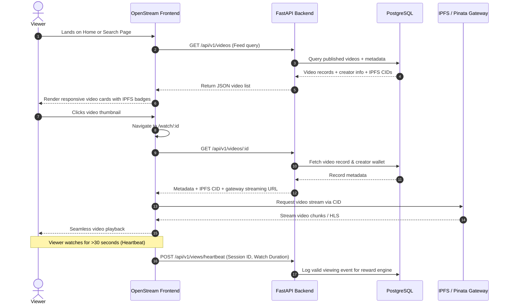
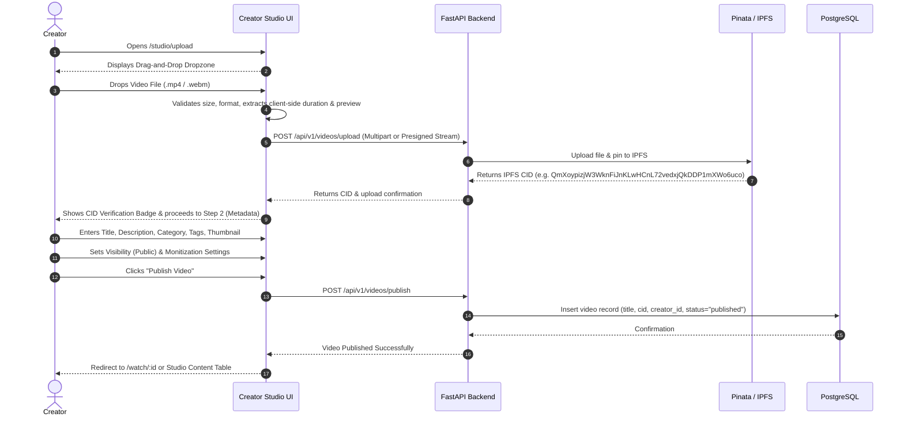
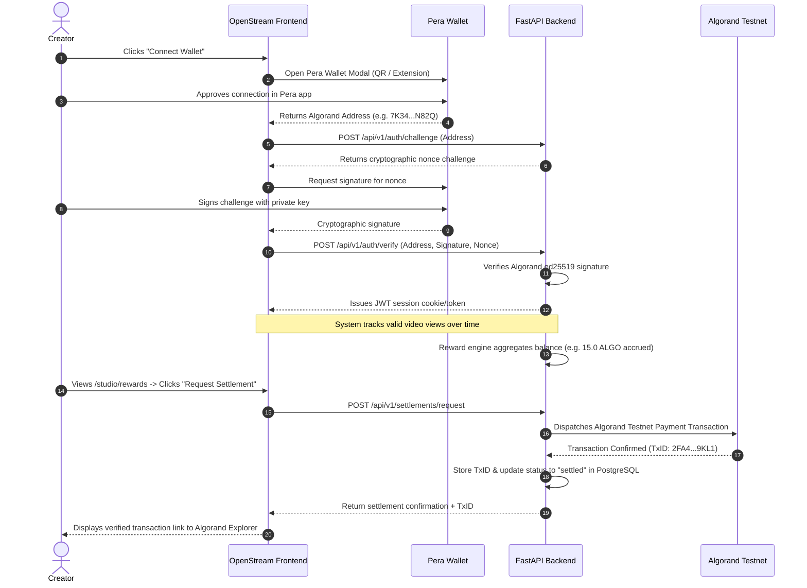

# OpenStream — UI/UX Design & Frontend Architecture Plan
**Phase 1: UI/UX Design and Frontend Planning**

> **Document Status:** Approved Design Architecture Blueprint  
> **Target Framework:** React + Vite + TypeScript + Tailwind CSS  
> **Design Theme:** Obsidian Prism (Derived via Google Stitch exploration)  
> **Primary Source of Truth:** [`PROJECT_CONTEXT.md`](file:///c:/web3/PROJECT_CONTEXT.md)

---

## 1. Executive Summary & Design Vision

OpenStream is a semi-decentralized video platform that merges familiar, high-performance streaming experiences with decentralized storage (IPFS / Pinata) and transparent creator reward settlements (Algorand Testnet & Pera Wallet).

### 1.1 The Visual & Product Objective
OpenStream must feel like a **modern video streaming platform**, a **professional creator studio**, and a **clean technology product**.

* **What it IS:**
  * Clean, cinematic, dark-themed streaming interface.
  * Professional creator tools matching enterprise SaaS standards.
  * Restrained, deliberate Web3 integration: blockchain addresses and IPFS CIDs are surfaced as badges of cryptographic authenticity and ownership, not marketing hype.
  * High-contrast, accessible typography and spacious layout geometry.

* **What it is NOT:**
  * It is **NOT** a generic crypto website with neon glow overlays, floating coins, or saturated purple-green gradients.
  * It is **NOT** a direct clone of YouTube—it has its own unique visual identity (Obsidian Prism), distinct card layout, transparent metric widgets, and integrated Web3 primitives.
  * It does **NOT** put non-essential features on the blockchain; fast queries and UI state are powered by PostgreSQL and FastAPI.

---

## 2. Information Architecture (IA)

The OpenStream information architecture separates public exploration, viewer streaming, creator studio workflows, advertiser campaign management, and platform administration.

```mermaid
graph TD
    Root["OpenStream App Shell"] --> PublicNav["Public Navigation"]
    Root --> ViewerNav["Viewer Experience"]
    Root --> CreatorNav["Creator Studio"]
    Root --> AdvertiserNav["Advertiser Portal"]
    Root --> AdminNav["Admin Console"]

    PublicNav --> Landing["/ Landing Page"]
    PublicNav --> About["/about Architecture & Transparency"]
    PublicNav --> Terms["/terms & /privacy"]

    ViewerNav --> Home["/feed Home & Featured Feed"]
    ViewerNav --> Category["/category/:id Dynamic Categories"]
    ViewerNav --> Search["/search Filtered Discovery"]
    ViewerNav --> Watch["/watch/:id Video Watch Experience"]
    ViewerNav --> Profile["/@:handle Creator Channel Page"]
    ViewerNav --> Library["/library Saved & History"]

    CreatorNav --> StudioDash["/studio Dashboard Overview"]
    CreatorNav --> UploadWizard["/studio/upload 4-Step Media Ingestion"]
    CreatorNav --> ContentMgr["/studio/videos Content Manager"]
    CreatorNav --> VideoEdit["/studio/videos/:id Edit Metadata"]
    CreatorNav --> StudioAnalytics["/studio/analytics Audience & View Stats"]
    CreatorNav --> RewardsLedger["/studio/rewards Monetization & Settlements"]
    CreatorNav --> WalletHub["/studio/wallet Pera Wallet HUD & History"]

    AdvertiserNav --> AdsDash["/ads Overview"]
    AdvertiserNav --> Campaigns["/ads/campaigns Campaign Manager"]
    AdvertiserNav --> NewCampaign["/ads/campaigns/new Create Campaign"]

    AdminNav --> AdminDash["/admin Health & Moderation"]
    AdminNav --> ModerationQueue["/admin/moderation Takedowns & Reports"]
    AdminNav --> SettlementMonitor["/admin/settlements On-chain Queue"]
```



### 2.1 Navigation Structure & Layout Shells

#### Global Application Shell (`AppShell`)
* **Persistent Top Header (64px):**
  * Brand Identity: OpenStream monogram + dynamic wordmark.
  * Global Search Bar: Autocomplete search with quick category tags and keyboard shortcuts (`Cmd/Ctrl + K`).
  * Center Category Pill Navigation: Sticky horizontal scrollable chips (`All`, `Tech`, `Tutorials`, `Creative`, `Web3 & Infra`, `Gaming`, `Podcasts`).
  * Quick Actions: `Upload Video` button (accent gradient), `Notifications` bell, `Wallet Status HUD` / `Connect Wallet` button, `User Profile` dropdown.
* **Collapsible Left Sidebar:**
  * **Standard View (Expanded - 240px):**
    * *Discover:* Home, Trending, Explore, Subscriptions.
    * *Library:* History, Watch Later, Liked Videos.
    * *Creator Studio:* Studio Dashboard, Content, Analytics, Earnings & Rewards.
    * *Network Status:* Algorand Testnet status pill (Block height, active node ping), IPFS Gateway health.
  * **Compact View (Rail - 72px):** Icon-only representation for maximized video grid canvas.
  * **Mobile Drawer:** Off-canvas slide-out sheet triggered by hamburger toggle.

#### Creator Studio Shell (`StudioShell`)
* Dedicated workspace layout for creators:
  * Persistent Studio Header: Breadcrumbs (`Studio > Content > Upload`), Creator Wallet balance badge (e.g. `124.50 ALGO`), "Quick Upload" button.
  * Dedicated Studio Left Sidebar: Dashboard, Content, Analytics, Rewards, Wallet & Settlements, Channel Settings.

---

## 3. Core User Flows

### 3.1 Viewer User Flow



### 3.2 Creator Upload & Publishing Flow



### 3.3 Wallet Connection & Algorand Reward Settlement Flow



---

## 4. Comprehensive Page Inventory

| # | Page Name | Route | Category | Core Purpose & Key Components |
|---|---|---|---|---|
| 1 | **Landing Page** | `/` | Public | Platform introduction, value proposition, decentralization architecture preview, featured creators, "Start Creating" & "Explore" CTAs. |
| 2 | **About & Transparency** | `/transparency` | Public | Visual explanation of how IPFS storage and Algorand settlement work; live Testnet stats, open protocol architecture. |
| 3 | **Home / Explore Feed** | `/feed` | Viewer | Primary discovery feed: Hero spotlight, category chips, responsive video card grid, trending carousel. |
| 4 | **Category Feed** | `/category/:slug` | Viewer | Filtered video feed by category (Tech, Creative, Education, Web3, Gaming). |
| 5 | **Search & Discovery** | `/search` | Viewer | Text search query results with multi-attribute filter drawer (Date, Duration, Category, Quality), creator cards, and empty state. |
| 6 | **Video Watch Page** | `/watch/:id` | Viewer | Custom HTML5 video player, metadata header, creator info banner, like/share/tip actions, IPFS CID explorer drawer, related videos column. |
| 7 | **Creator Channel Page** | `/@:handle` | Viewer | Channel banner, creator avatar, verification badge, channel bio, Algorand address badge, tabbed navigation (Videos, Playlists, About). |
| 8 | **Personal Library** | `/library` | Viewer | History of viewed videos, liked videos, saved watch-later list. |
| 9 | **Creator Studio Overview** | `/studio` | Creator | Analytics summary cards (Views, Watch Time, ALGO Earnings, Followers), recent uploads quick table, upload shortcut. |
| 10 | **Video Upload Wizard** | `/studio/upload` | Creator | 4-step wizard: 1) File dropzone & IPFS CID preview, 2) Metadata & thumbnail, 3) Monetization & tags, 4) Review & publish. |
| 11 | **Content Manager** | `/studio/videos` | Creator | Interactive table of all uploaded videos with status badges (Published, Processing, Draft), view count, earnings per video, delete/edit actions. |
| 12 | **Video Edit Studio** | `/studio/videos/:id/edit` | Creator | Metadata editor: update title, description, thumbnail, visibility, and tags. |
| 13 | **Studio Analytics** | `/studio/analytics` | Creator | In-depth time-series chart of views, audience retention curve, geography, valid vs filtered bot views. |
| 14 | **Monetization & Rewards** | `/studio/rewards` | Creator | Real-time reward balance counter, earnings breakdown, settlement threshold tracker, "Request Settlement" trigger. |
| 15 | **Wallet & Settlements** | `/studio/wallet` | Creator | Pera Wallet status card, connected address, past settlement ledger table with Algorand transaction IDs and explorer links. |
| 16 | **Channel Customization** | `/studio/settings` | Creator | Profile editing: avatar, banner image, creator bio, social links, default video upload preferences. |
| 17 | **Advertiser Dashboard** | `/ads` | Advertiser | Campaign metrics (impressions, CTR, spend), active campaigns overview. |
| 18 | **Create Ad Campaign** | `/ads/campaigns/new` | Advertiser | Ad creative upload, targeting parameters, budget in ALGO, duration. |
| 19 | **Admin Console** | `/admin` | Admin | System health, moderation queue for flagged videos, creator verification approvals, Algorand node connectivity status. |

---

## 5. Design System: "Obsidian Prism"

Derived from the visual exploration in Google Stitch and calibrated for a high-performance creator and streaming ecosystem.

### 5.1 Color Palette & Semantics

```css
:root {
  /* Canvas & Structural Foundations */
  --color-canvas-base: #0A0D14;          /* Pure obsidian slate bedrock */
  --color-surface-container-1: #131926;  /* Primary card, panel, and feed surface */
  --color-surface-container-2: #1B2234;  /* Hovered cards, inputs, dropdowns */
  --color-surface-container-3: #232B42;  /* Elevated dialogs, popovers, tooltips */
  --color-surface-stroke: #1E293B;       /* 1px subtle card boundary stroke */
  --color-surface-stroke-hover: #334155; /* Interactive hover boundary stroke */
  --color-surface-specular: rgba(255, 255, 255, 0.08); /* Top edge specular highlight */

  /* Brand Accents */
  --color-brand-primary: #6366F1;        /* Indigo: core CTAs, active pills, player scrub */
  --color-brand-primary-hover: #4F46E5;  /* Deepened indigo hover */
  --color-brand-primary-subtle: rgba(99, 102, 241, 0.12); /* Selected tab background */
  
  /* Telemetry & Network Indicators */
  --color-network-emerald: #10B981;      /* Live broadcast, verified IPFS, settled ALGO */
  --color-network-emerald-subtle: rgba(16, 185, 129, 0.12);
  --color-network-amber: #F59E0B;        /* Processing video, pending settlement */
  --color-network-amber-subtle: rgba(245, 158, 11, 0.12);
  --color-network-ruby: #EF4444;         /* Error state, failed transaction, takedown */
  --color-network-ruby-subtle: rgba(239, 68, 68, 0.12);

  /* Typography & Contrast Tiers */
  --color-text-primary: #F8FAFC;         /* High-contrast crisp white for headlines */
  --color-text-secondary: #94A3B8;       /* Slate-400 for subtext, metadata, table copy */
  --color-text-muted: #475569;           /* Slate-600 for disabled states, placeholders */
}
```

### 5.2 Typography System

The typography uses a triple-family hierarchy designed for legibility, media display, and cryptographic telemetry:

1. **Display & Headings: `Geist` / `Outfit`**
   * Geometric, crisp sans-serif with tight negative tracking (`-0.025em`) for modern digital craftsmanship.
   * Sizes:
     * `Display XL`: 64px / 72px line-height (Hero Landing headline)
     * `Headline LG`: 40px / 48px line-height (Section headers)
     * `Headline MD`: 28px / 36px line-height (Page titles, Watch page title)
     * `Headline SM`: 20px / 28px line-height (Card titles, modal titles)

2. **Interface & Body: `Inter`**
   * Highly legible, neutral workhorse sans-serif for UI copy, forms, and descriptions.
   * Sizes:
     * `Body LG`: 18px / 28px line-height (Introductory copy)
     * `Body MD`: 15px / 24px line-height (Primary body, descriptions)
     * `Body SM`: 13px / 20px line-height (Metadata, timestamps, secondary labels)

3. **Telemetry & Code: `JetBrains Mono`**
   * Technical monospaced font used for IPFS CIDs, Algorand public addresses, transaction hashes, timecodes (`04:32`), bitrates, and raw balances.
   * Sizes:
     * `Label Code`: 12px / 16px line-height (CIDs, Algorand TxIDs, durations)
     * `Label Code SM`: 11px / 14px line-height (Compact badges)

### 5.3 Spacing, Borders, and Elevation

* **Spacing Scale:** Built on an 8pt spatial baseline:
  * `xs` (4px), `sm` (8px), `md` (16px), `lg` (24px), `xl` (32px), `2xl` (48px), `3xl` (64px).
* **Border Radii:**
  * Small UI controls, Buttons, Input fields: `8px` (`rounded-lg`)
  * Cards, Video thumbnails, Data containers: `14px` (`rounded-xl`)
  * Hero containers, Media Player wrappers: `16px` (`rounded-2xl`)
  * Badges, Status pills, Category tags: `9999px` (`rounded-full`)
* **Elevation & Layering:**
  * Avoid heavy colorful drop shadows.
  * Use **tonal layering**: Elevated components use `#1B2234` or `#232B42` against the `#0A0D14` bedrock with a crisp `1px solid #1E293B` border and subtle ambient shadow `0 16px 32px -8px rgba(0, 0, 0, 0.6)`.

---

## 6. Component Architecture

The frontend will be built from modular, highly reusable atomic components categorized as follows:

### 6.1 Layout & Navigation Components
* `AppShell`: Global responsive layout wrapper with header, sidebar, and dynamic page container.
* `StudioShell`: Creator Studio layout wrapper with studio sidebar and metric status bar.
* `Header`: Top navigation bar with Logo, GlobalSearch, Upload CTA, WalletStatusHUD, and ProfileMenu.
* `Sidebar`: Collapsible sidebar supporting Expanded, Rail (icon-only), and Mobile Drawer modes.
* `CategoryPills`: Horizontal scrollable bar of category chips with active filter state.

### 6.2 Video & Media Components
* `VideoCard`:
  * 16:9 thumbnail wrapper with duration badge (`08:45`) and hover poster scrub effect.
  * Video Title (2-line clamp).
  * Creator avatar + Verified Creator badge.
  * Channel name, view count, and relative upload date (`2 days ago`).
  * Cryptographic indicator: Hoverable pill showing `IPFS CID` with copy icon.
* `VideoGrid`: Responsive CSS grid (1 to 4 columns) with skeleton loading placeholders.
* `VideoPlayer`:
  * Custom HTML5 player overlay styled in Obsidian theme.
  * Controls: Play/Pause, 10s Skip/Back, Scrub bar with buffer preview, Volume slider, Fullscreen, Theatre Mode.
  * Quality badge: 1080p / 720p indicator.
  * IPFS Gateway Latency indicator (e.g. `IPFS Direct • 42ms`).
* `IPFSBadge`: Reusable badge displaying `IPFS Hosted` with tooltip linking to decentralized gateway.
* `RelatedVideosList`: Vertical compact video card list for the Watch Page sidebar.

### 6.3 Creator & Studio Components
* `UploadDropzone`:
  * Large dashed container with cloud-upload icon.
  * Local file validation (supports `.mp4`, `.mov`, `.webm`, max 2GB).
  * Instant local preview extraction and video duration calculation.
* `UploadProgressModal`:
  * Multi-step wizard indicator: 1) File Staging, 2) IPFS Pinning, 3) Metadata & Thumbnail, 4) Visibility & Publish.
  * Real-time progress bar with bytes transferred and simulated IPFS CID hash generation.
* `MetricCard`:
  * Creator statistic pod: Title, numerical metric in bold `Geist`, percentage trend indicator (`+14.2%` in emerald), and miniature sparkline chart.
* `ContentTable`:
  * Sortable, filterable table showing video thumbnails, title, upload date, visibility status pill (Published, Processing, Draft), view count, and ALGO earnings.
  * Action dropdown: Edit, Copy IPFS Link, View On-chain Record, Delete.
* `RevenueChart`: Clean time-series SVG chart showing daily views vs ALGO reward accruals.

### 6.4 Web3 & Wallet Components
* `WalletConnectModal`:
  * Modal with Pera Wallet integration branding.
  * QR Code presentation for Pera mobile app scanning.
  * Pera Web / Extension button for desktop browser extension.
  * Nonce signing status indicator.
* `WalletStatusHUD`:
  * Compact pill in the header displaying:
    * Algorand Logo icon.
    * Truncated public address (`7K34...N82Q`).
    * Network pill (`Testnet`).
    * Click opens Wallet Drawer with balance, disconnect action, and Algorand Explorer link.
* `SettlementCard`:
  * Card displaying "Unsettled Creator Balance" (e.g. `14.50 ALGO`).
  * Settlement threshold progress bar (e.g. `14.50 / 20.00 ALGO` to auto-settle).
  * "Request Settlement" action button.
* `TransactionRow`:
  * Ledger entry displaying Date, Amount in ALGO, Recipient Address, Settlement Status (Confirmed / Pending), and clickable Algorand Transaction ID linking to testnet explorer.

### 6.5 Interactive Feedback & UX State Components
* `SkeletonVideoCard`: Shimmer card placeholder matching `VideoCard` dimensions.
* `SkeletonWatchPage`: Shimmer placeholders for player, title, and comments.
* `EmptyState`: Contextual illustrated placeholder with title, description, and primary CTA (e.g. "No videos uploaded yet").
* `ErrorBanner`: Dismissible alerting banner for network timeouts or upload failures.
* `ToastNotification`: Stacked notifications for action feedback ("CID copied to clipboard", "Settlement broadcasted").

---

## 7. UX States & Edge Cases

The interface must handle every state gracefully without broken layouts or unhandled errors:

| UX State | Visual Treatment & Behavior |
|---|---|
| **Loading State** | Subtle, elegant shimmer skeletons matching exact component dimensions. No jarring layout shifts (CLS = 0). |
| **Empty State** | Clean, minimalist SVG icon with reassuring text and an immediate action button (e.g. "Upload Your First Video"). |
| **Video Processing** | Amber pulsing badge `IPFS Pinning in Progress` with estimated time remaining and explanation of decentralized propagation. |
| **IPFS Gateway Error** | Fallback mechanism banner: "Primary IPFS gateway slow. Attempting fallback decentralized gateway..." with a manual retry button. |
| **Wallet Disconnected** | Smooth fallback: Viewers can continue browsing and watching seamlessly. Creator actions prompt the `WalletConnectModal` with a clear explanation of why signing is needed. |
| **Network Mismatch** | Prominent warning banner if connected wallet is on Algorand Mainnet instead of Testnet: "Please switch Pera Wallet to Algorand Testnet". |
| **Settlement Pending** | Clock icon with "Transaction submitted to Algorand Testnet. Waiting for block confirmation... (~4.5s)". |

---

## 8. Responsive Layout Strategy

| Viewport | Breakpoint | Layout Adaptations |
|---|---|---|
| **Desktop (Large)** | `>= 1280px` | Full 12-column grid. Expanded sidebar (240px). 4-column video feed grid. Watch page uses 72% player + 28% related video sidebar. Full Studio data tables. |
| **Laptop** | `1024px - 1279px` | 3-column video feed grid. Sidebar collapses to compact 72px rail to give video content maximum breathing room. Watch page adjusts to 65% / 35%. |
| **Tablet** | `768px - 1023px` | 2-column video feed grid. Sidebar becomes a hidden off-canvas drawer. Watch page stacks: full-width video player on top, description below, followed by related videos. |
| **Mobile** | `< 768px` | 1-column video feed with edge-to-edge thumbnails. Persistent bottom navigation bar (`Home`, `Explore`, `Upload`, `Studio`, `Wallet`). Watch page features a sticky video player at the top of the screen. Upload wizard adapts into single-column vertical cards. Dialogs render as bottom sheets. |

---

## 9. Google Stitch Design Plan

We leverage Google Stitch to explore and validate key screens before beginning frontend coding.

### Screen Execution Priority:
1. **Screen 1: Landing Page** *(Completed & Generated!)*
   * Established the **Obsidian Prism** design theme, color palette, typography hierarchy (`Geist` + `Inter` + `JetBrains Mono`), and core visual tenets.
2. **Screen 2: Home / Video Explore Feed**
   * Validates video discovery, category chip navigation, video card design with IPFS indicators, and sidebar integration.
3. **Screen 3: Video Watch Page**
   * Validates the custom video player, creator verification row, on-chain tipping/interaction buttons, IPFS metadata drawer, and related videos column.
4. **Screen 4: Video Upload Studio**
   * Validates the drag-and-drop dropzone, multi-step progress bar, IPFS CID generation feedback, and metadata inputs.
5. **Screen 5: Creator Studio Dashboard**
   * Validates creator analytics cards, audience retention charts, recent uploads table, and Algorand earnings overview.
6. **Screen 6: Wallet & Rewards Settlement Hub**
   * Validates Pera Wallet connection status card, reward ledger table, and on-chain Algorand transaction verification links.

---

## 10. Next Steps & Phase Handoff

In accordance with Section 13 and 14 of the prompt:
* **STOP HERE.** Do not write backend code, setup databases, configure IPFS, or connect Algorand yet.
* Review this comprehensive UI/UX Architecture and Design System Plan.
* Upon approval, proceed to **Phase 2: Frontend Foundation** to initialize the React + Vite + TypeScript + Tailwind CSS application using the approved Obsidian Prism design system.
